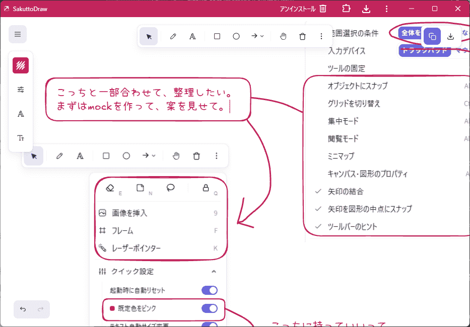

<p align="center">
  
</p>

<h1 align="center">SakuttoDraw</h1>

<p align="center">
  Excalidraw をベースに、スクリーンショットへの素早い注釈付けと画像書き出しに用途を絞ったローカル完結の Web アプリ（PWA）です。<br />
  リアルタイム共同編集やクラウド共有機能を持たず、描画・画像書き出しをすべてブラウザ内で完結させます。
</p>

<p align="center">
  <a href="https://mottcha.github.io/SakuttoDraw/">
    
  </a>
</p>

---

<p align="center">
  
</p>

---

## Excalidraw からの変更点

- **貼って、描いて、すぐコピー**  
  スクショ注釈に特化した UI に最適化しています。  
  ペンや黒塗り、PNG / SVG でのクリップボードコピーや画像保存もボタン一つで！

- **日本語向けに最適化した 5 系統フォント**  
  手書き・標準・ポップ・コード・コード（手書き風）すべてで自然な日本語表示に対応。  
  手書きフォントで一部の漢字が中国語字形になってしまう問題も解消しています。

- **外部通信ゼロ**  
  クラウド同期や外部 CDN へのアクセスは一切ありません。  
  フォントを含む全アセットをセルフホストし、厳格な CSP で外部通信を遮断しています。

- **オフライン完結（PWA）& 必要なフォントだけ事前キャッシュ**  
  PWA としてローカルアプリのように使えます。  
  オフラインでも使えるよう、日本語・韓国語・中国語のフォントを必要な分だけ明示的にダウンロードできます。

- **日々の注釈作業を速くする独自設定**  
  起動時リセット、デフォルトのペン色・背景色、確認スキップ、モダンな右クリックメニューなど

| スタイル | 日本語優先時のフォント | 変更点 |
| --- | --- | --- |
| **手書き** | Excalifont + SetoJP（瀬戸フォント系） | Excalidraw 採用の Xiaolai Font では一部漢字が中国語字形になるため、元となった瀬戸フォントから誤字修正された KosefontP-JP を採用 |
| **標準** | BIZ UDPGothic Bold | Nunito に日本語フォールバックがなかったため、小さい注釈やフォーマルな場面でも潰れにくい UD フォントを採用 |
| **ポップ** | Lilita One + Mochiy Pop P One | Lilita One に日本語フォールバックがなかったため、見出しや強調に映えるポップ書体を追加 |
| **コード** | SakuttoCode | 半角 1:2 揃え・罫線文字・合字 ON/OFF に対応。UDEV Gothic / LG をベースにサブセット化（OFL 1.1 の RFN 条項に従い改称） |
| **コード（手書き風）** | Comic Shanns (1:2) + SetoJP | 手書き風コードでも半角・全角が 1:2 でずれないよう横幅を調整し、日本語に対応 |

---

## 開発・ビルド

```bash
npm install
npm run dev      # 開発サーバー起動
npm run test     # テスト実行
npm run build    # 本番ビルド (dist/)
```

`main` ブランチへのプッシュで `.github/workflows/deploy.yml` により GitHub Pages へデプロイされます。

---

## ライセンス・クレジット

- 本リポジトリのソースコードは [MIT License](LICENSE) のもとで公開されています。
- 描画エンジンとして [@excalidraw/excalidraw](https://github.com/excalidraw/excalidraw)（MIT License）を使用しており、その他のバンドル済み OSS ライブラリおよび同梱フォントの著作権表示・ライセンス全文は [THIRD-PARTY-NOTICES.txt](public/THIRD-PARTY-NOTICES.txt) に記載しています。
